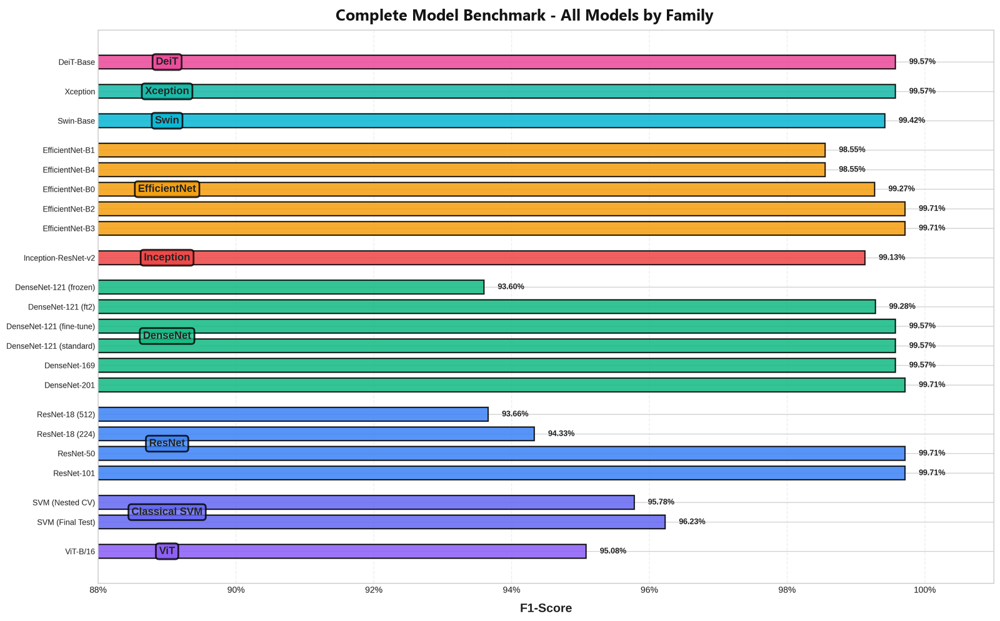
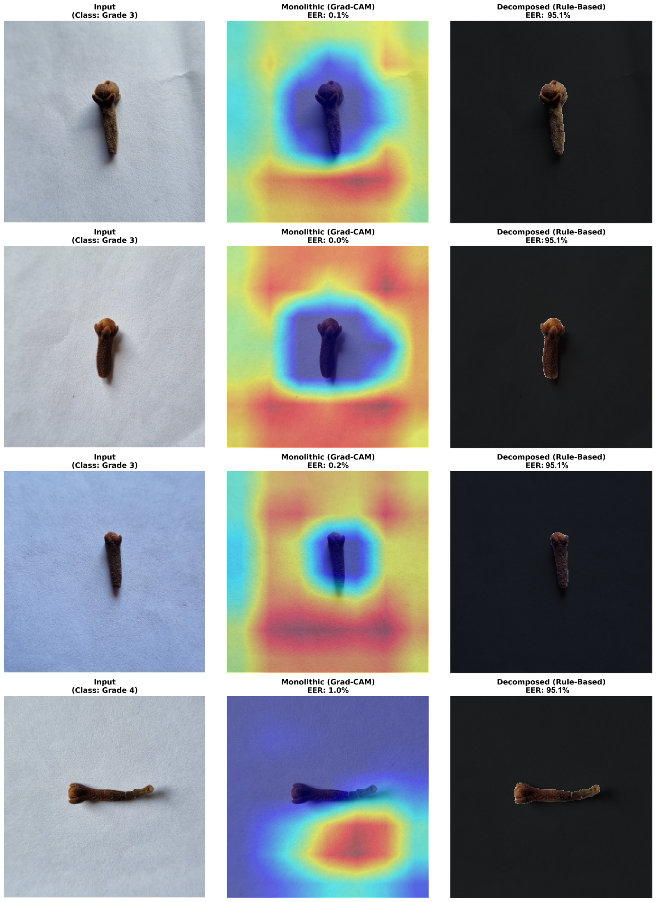

# ZSTC-Clove-V1: Deep Learning Feasibility Study for Automated Clove Quality Classification

**Presented at the 4th EAC STI Conference / AI for East Africa Conference (AI4EAC 2026, Kigali, Rwanda)**  
*Recipient of the AI4EAC 2026 Competitive Student Travel Grant ($980).*

[](https://saaillab.github.io/zstc-clove-v1/)
[](https://saaillab.github.io/papers/zstc-clove-v1/)
[](LICENSE)

**Authors:** Patrick Vincent Ndowo, Innocent Nyalala  
**Affiliation:** SAAIL Lab, School of Engineering and Science, Indian Institute of Technology Madras Zanzibar, Tanzania  



---

## Abstract

Manual commercial clove grading in Zanzibar governs export revenue and smallholder livelihoods across more than 53% farmgate price differentials between Grade I and Grade IV harvests, yet subjective human visual inspection introduces disputes and pricing inconsistency. This study introduces **ZSTC-Clove-V1**, a **5,298-image single-clove dataset** photographed at the Saateni ZSTC grading warehouse across Unguja and Pemba commercial grades, and conducts an end-to-end architectural feasibility and spatial interpretability audit. Although **ResNet-18** reaches **94.46% test accuracy** (`94.33%` Macro-F1), unmodified **VGG-16 collapses at 31.32% accuracy** (`14.94%` Macro-F1), and Grad-CAM attribution audits expose subtle tray-background sensitivity alongside clove bud discoloration.

---

## Dataset Composition by ZSTC Commercial Grade (`N = 5,298`)

Certified ZSTC warehouse inspectors annotated all `5,298` single-clove photographs with substantial inter-annotator agreement (`κ = 0.87`), partitioned deterministically into `70%` train (`3,709`), `15%` validation (`795`), and `15%` held-out test (`794`):

| ZSTC Grade | Quality Tier | Total Images | Train (70%) | Val (15%) | Test (15%) |
|---|---|---:|---:|---:|---:|
| **Grade I** | Premium Golden / Crown | 1,455 | 1,019 | 218 | 218 |
| **Grade II** | Standard Commercial | 1,320 | 924 | 198 | 198 |
| **Grade III** | Lower Faded Grade | 1,398 | 979 | 210 | 209 |
| **Grade IV** | *Mpeta* / Defective | 1,125 | 787 | 169 | 169 |
| **Total** | **All 4 Commercial Grades** | **5,298** | **3,709** | **795** | **794** |

---

## Quantitative Architectural Feasibility Comparison (`n = 794` Test)

| Architecture | Test Accuracy (%) | Macro Precision (%) | Macro Recall (%) | Macro F1 (%) | Diagnostic Finding |
|---|---:|---:|---:|---:|---|
| **ResNet-18** | **94.46** | **94.39** | **94.34** | **94.33** | Residual skip connections stabilize gradient flow on small-object cloves |
| **VGG-16** | 31.32 | 9.81 | 31.32 | 14.94 | Collapses toward majority-class predictions on single-clove textures |

---

## Spatial Attention & Trustworthiness Findings

- **Accuracy Alone Masks Shortcuts:** Post hoc Grad-CAM overlays reveal that unmasked CNN classifiers partially attend to metallic inspection tray brightness and lighting gradients around bud boundaries.
- **Residual Gradient Stability vs. VGG Collapse:** Sequential `3 x 3` convolutional stacks without skip connections fail to resolve subtle calyx and stem texture boundaries (`14.94%` Macro-F1), whereas residual shortcuts recover fine surface discrimination (`94.33%` Macro-F1).
- **Direct Motivation for Follow-On SAAIL Lab Studies:**
  1. **Explanation Evidence Ratio (ETRI Journal 2026):** Replacing end-to-end monolithic classification with segmentation-first U-Net + ResNet-18 compositional inference achieves `100% EER` and `99.45%` F1 (`DOI: 10.4218/etrij.2026-0225`).
  2. **Capture-Session Confounding (`Under Review`):** Proves background-swap probes can override unmasked classifiers at up to 53%–57% flip rates without foreground bud isolation.



---

## Commercial Context & Mobile Translation (`Ubora-AI`)

Constructed with certified ZSTC grading inspectors at the Saateni warehouse, **ZSTC-Clove-V1** captures 5,298 individual buds spanning commercial Grades I through IV (tracking whole, dark, headless stem, and split *mpeta* defects). Together with our participatory design work at ACM AfriCHI 2025, these prototypes power the **Ubora-AI** Flutter/Android TFLite INT8 inspection application built for offline smallholder warehouse deployment.

- **Full Project Suite:** [Ubora-AI Project Website](https://saaillab.github.io/projects/ubora-ai/)
- **Standardized 4,603-Image Benchmark:** [CLOVES-4603 (CVPR 2026 V4A)](https://saaillab.github.io/papers/cloves-4603/)
- **Mobile Prototypes Directory:** [SAAIL Lab Tools](https://saaillab.github.io/tools/)

---

## Reproducibility Protocol & Practical Guidance

1. **Standardized Input Preprocessing:** Single-clove frames undergo center framing and bilinear resizing to `224 x 224` RGB with ImageNet channel statistics prior to training ResNet-18 and VGG-16 backbones across deterministic splits (`3,709` train / `795` val / `794` test).
2. **Mandatory Foreground Isolation Before Field Rollout:** Although `ResNet-18` achieves `94.46%` test accuracy on controlled tray acquisitions, follow-on Explanation Evidence Ratio (`EER`) checks confirm that production inspection apps must pair lightweight U-Net foreground segmentation with classification so grading decisions rest strictly on calyx and stem morphology rather than background surfaces.
3. **Fair Farmgate Impact:** Objective visual grading tools built on **ZSTC-Clove-V1** reduce subjective moisture/defect deductions during cooperative auctions, helping farmers secure consistent Grade I/II valuations.

---

## Ethical Data Curation & Usage License

- **Collector & Institutional Oversight:** All photographs were collected at the Saateni ZSTC grading warehouse in Unguja, Zanzibar with direct participation of certified institutional grading officers and farmgate quality inspectors.
- **Open Research Availability:** Benchmark tables, preprocessing scripts, and documentation are released under the [MIT License](LICENSE) for non-commercial agricultural quality research and cooperative decision-support prototyping.

---

## Repository Contents

```text
zstc-clove-v1/
├── README.md
├── LICENSE
├── CITATION.cff
└── docs/
    ├── index.html                        # Standalone AI4EAC 2026 project page
    └── assets/
        ├── figure_benchmark_f1.png       # ResNet-18 vs VGG-16 Macro-F1 comparison
        ├── figure_03_gradcam.png         # Grad-CAM background attribution audit
        └── saail-crest.png
```

---

## Citation

```bibtex
@inproceedings{ndowo2026zstcclovev1,
  title={Deep Learning Feasibility Study for Automated Clove Quality Classification Using CNN Architectures on a Novel Zanzibar Dataset},
  author={Ndowo, Patrick Vincent and Nyalala, Innocent},
  booktitle={4th EAC STI Conference / AI for East Africa Conference (AI4EAC 2026)},
  address={Kigali, Rwanda},
  year={2026},
  month={March},
  url={https://github.com/saaillab/zstc-clove-v1}
}
```

Maintained by **[SAAIL Lab](https://saaillab.github.io/)**, School of Engineering and Science, Indian Institute of Technology Madras Zanzibar, Tanzania.
